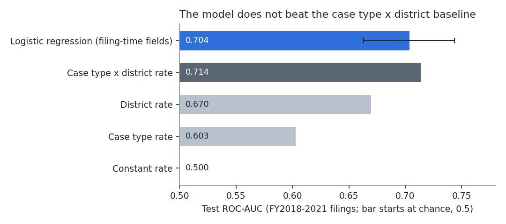
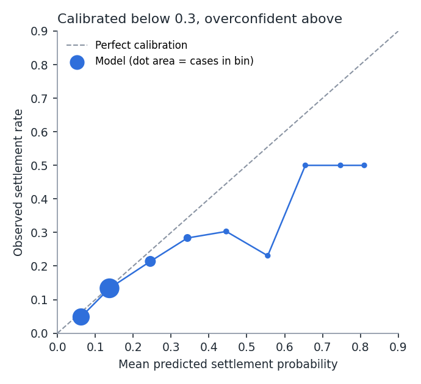

# courtpipe

**Can you predict how corporate federal litigation turns out using only what is known before the ruling, and how can you tell if the model has actually learned something?**

courtpipe predicts outcomes in U.S. federal lawsuits against corporate defendants: whether a case settles, whether a motion to dismiss is granted, and whether a judgment is reversed on appeal. It uses public court data. Each track starts with a spec written before any data is pulled, and its model has to clear that spec's bars. Some tracks fail. Those results are published too.

| Track | Question | Data | Status |
| --- | --- | --- | --- |
| [Settlement at filing](#result-settlement-at-filing) | Will this case settle? | FJC Integrated Database, 11M federal civil cases | **Scored. Negative result:** the model does not beat a case type x district baseline |
| [Motion to dismiss](docs/mtd/SPEC.md) | Will a Rule 12(b)(6) motion by a corporate defendant be granted? | CourtListener RECAP dockets and filings | Spec approved, pipeline built and tested on synthetic data; live extract next |
| [Appeal reversal](docs/appeal-reversal-spec.md) | Will the court of appeals disturb the district court's judgment? | CourtListener bulk opinions | Spec approved, pipeline built and tested on synthetic data; bulk snapshot next |
| [Opinion outcome labeler](#opinion-outcome-labeler) | What did the court do in this opinion? | CourtListener opinions | Done. This is the extraction tool, not a predictor |

## How models are evaluated

Each prediction track has the same protocol, fixed in its spec before any data is scored:

- **Only pre-decision information.** Features are limited to what existed before the ruling. Each spec lists forbidden fields by name. For example, the settlement track bans `PROCPROG`, a field that records how far the case got before it ended. Using it would leak the answer. Tests check the feature builders for leakage.
- **Temporal split.** Train on older cases and test on newer ones. A docket never appears on both sides of the split. Defendants who appear in training are dropped from the test set, and test cases that couldn't have finished by the extract date are censored.
- **Binding baselines.** The model has to beat the *best* simple rate baseline: rates by case type, by court, by case type x court and, where available, by judge. Beating a constant rate doesn't count. The baselines are fit on training data, but the one the model must beat is the one that scores best on the test set. That choice is deliberately harsh.
- **Intervals, not point estimates.** Comparisons use 1,000-draw bootstraps of the test set, resampled by docket where a docket has several rows. A bar passes only if the lower end of the 95% interval for the improvement is above zero.
- **Hand-audited labels.** Two readers check a stratified sample of the automatic labels. A label counts as usable only if the 95% Wilson lower bound on its accuracy clears the spec's threshold and Cohen's kappa is at least 0.60.
- **Negative results are results.** A failed bar is reported as a completed evaluation. It is never tuned until it passes.

## Result: settlement at filing

*Can filing-time fields predict whether a federal case against a corporation settles?*

**Data:** the Federal Judicial Center's public civil Integrated Database (10.96M rows scanned). The cohort is stockholder suits, antitrust and securities cases (nature of suit 160, 410 and 850) filed FY2010 to FY2021 with a corporate first-listed defendant. The label is disposition code 13 (settled). Spec: [`docs/idb/SPEC.md`](docs/idb/SPEC.md).

**Split:** 4,864 training cases (FY2010 to FY2017) and 1,196 test cases (FY2018 to FY2021). 2,491 test cases were censored because a case filed then that ran as long as the training 95th percentile (2,574 days) could not have finished by the extract date. 401 more were dropped because their defendant also appears in training. The settlement rate falls from 22.6% in training to 13.4% in test.

**Model:** logistic regression on the fields in the civil cover sheet: circuit, district and office; case type; origin; jurisdiction basis and diversity residence; county; jury demand; class-action allegation; amount demanded (binned, with a missing flag); arbitration, pro se and fee-status flags; filing month; and a year trend.



| | Model | Best baseline (case type x district) | Difference, 95% CI | Bar |
| --- | --- | --- | --- | --- |
| ROC-AUC | 0.704 [0.663, 0.744] | 0.714 | -0.010 [-0.047, +0.026] | fail |
| Brier score | 0.111 | 0.112 | +0.001 [-0.004, +0.006] | fail |

**Reading it:** the model ranks cases well above chance and beats the constant, case type and district baselines. But nearly all of that signal is already in *which court* and *what kind of case*. The other filing-time fields add nothing measurable. A leave-one-fiscal-year-out check makes the same point: dropping FY2013 or FY2015 from training flips the sign of the gap. So this is not a settlement predictor, and the README doesn't call it one.



Calibration is good where most cases are. 77% of test cases get a predicted probability below 0.2, and observed rates track predictions closely there. Above 0.3 the model is overconfident, though those bins hold few cases.

**Still open:** the 150-row two-reader audit of the code-13 label ([`audit_sample.csv`](docs/idb/audit_sample.csv), [rubric](docs/idb/AUDIT_RUBRIC.md)). Until that audit's Wilson lower bound on precision clears 0.5, code 13 isn't treated as a validated settlement label. Full numbers: [`docs/idb/RESULTS.md`](docs/idb/RESULTS.md) and [`settlement_report.json`](docs/idb/settlement_report.json).

## In progress: motion to dismiss and appeal reversal

Both pipelines are built: cohort selection, labeling, leakage-checked features, baselines and evaluation. Both run end to end on synthetic fixtures in CI. Neither has a result on real data yet, so this README reports none. The fixture metrics in `docs/mtd/RESULTS.md` and `docs/appeal/RESULTS.md` only show that the code runs. They are not findings.

- **Motion to dismiss** ([spec](docs/mtd/SPEC.md), [evaluation protocol](docs/mtd/EVALUATION.md)). One row per Rule 12(b)(6) motion by a corporate defendant in stockholder, antitrust, consumer credit or securities cases, 2016 to 2023. The label is granted, granted in part or denied, with leave to amend recorded as a modifier. Inputs are the complaint, the briefs and the docket metadata filed before the order. The judge baseline is the bar to beat, because judge identity alone can memorize grant rates.
- **Appeal reversal** ([spec](docs/appeal-reversal-spec.md)). One row per appeal. The label is reversed, vacated, remanded or mixed versus a pure affirmance, across all 13 circuits. It is built from CourtListener's quarterly bulk snapshot rather than the rate-limited API.

## Data and ethics

- Public sources only: the FJC Integrated Database and CourtListener. Nothing is scraped against a site's terms.
- No case-level extracts are committed. Caches and extracts are gitignored. Only aggregate results are published.
- No per-judge scores, ranks or rates are published. A judge can be a model feature, but the judge baseline is reported as a single aggregate number.
- API keys come from the environment and are never logged or written to reports.

## Reproduce

```bash
python -m venv .venv && source .venv/bin/activate
pip install -e ".[dev]"
python -m pytest                      # offline: labelers, leakage fixtures, evaluation
```

Settlement track (public data, no API key):

```bash
python scripts/download_idb.py --out data/idb/cv88on.zip     # FJC civil file, ~330 MB
courtpipe evaluate-settlement --idb data/idb/cv88on.zip --report docs/idb/settlement_report.json
python scripts/idb_figures.py                                 # the two charts above
```

Recorded run: file SHA-256 `74405231…bbac7223d`, extract as-of date 2026-08-26.

Motion to dismiss and appeal reversal need a CourtListener token. Copy `.env.example` to `.env` (gitignored) and set `COURTLISTENER_API_TOKEN`. Then:

```bash
courtpipe fetch-mtd --max-dockets 40 --out data/extracted/mtd_extract.jsonl
courtpipe evaluate-mtd --extract data/extracted/mtd_extract.jsonl \
  --report data/model-eval/mtd_report.json --results-md docs/mtd/RESULTS.md

courtpipe fetch-appeal --max-clusters 80 --out data/extracted/appeal_extract.jsonl
courtpipe evaluate-appeal --extract data/extracted/appeal_extract.jsonl --snapshot-year 2025 \
  --report data/model-eval/appeal_report.json --results-md docs/appeal/RESULTS.md
```

To run either on synthetic fixtures without a token, use `tests/fixtures/{mtd,appeal}/build_extract.py`. `courtpipe --help` lists every command.

## Opinion outcome labeler

This was the project's first stage, and it is still the label source for the opinion-based tracks. It is an ETL pipeline over CourtListener opinions:

1. **Extract** opinions for a query, with court, jurisdiction and citation metadata.
2. **Label** what the court did from the opinion text, using rules: `affirmed`, `dismissed`, `reversed`, `vacated`, `remanded`, `mixed` or `other`. Each label comes with an evidence snippet and a 0 to 1 confidence score.
3. **Triage.** Labels that are `other`, `mixed`, or have confidence below 0.60 go to a human review queue (`data/processed/review_queue.csv`) instead of being trusted silently.

```bash
courtpipe run --query "corporation" --max-cases 500
python scripts/fixture_results.py --out docs/examples/fixture-run   # offline 20-row demo
```

This stage *extracts* outcomes from text that already contains them. Its classifier metrics measure extraction, not prediction, which is why the prediction tracks above use separate cohorts and pre-decision features. Data dictionary: [`data/reference-tables/`](data/reference-tables/).

## Repository layout

```
courtpipe/    CLI entry point (courtpipe ...)
etl/          opinion extract / transform / load
analysis/     idb_*.py settlement track; mtd/ and appeal/ predictors; shared metrics and CourtListener client
vis/          charts for the opinion pipeline
scripts/      IDB download, README figures, offline fixture demo
docs/         specs, evaluation protocols, audit samples and recorded results per track
tests/        offline pytest suite with synthetic fixtures (runs in GitHub Actions)
```

## Limitations

- The settlement label is FJC disposition code 13. That code is a docket clerk's entry, and its accuracy hasn't been audited yet.
- RECAP contains only what someone uploaded. Motion-to-dismiss coverage won't match the national docket, and missing PDFs stay missing rather than being filled in.
- Filing-time fields are thin. The settlement result suggests that useful signal will need the text of the complaint and briefs, which the motion-to-dismiss track is designed to test.
